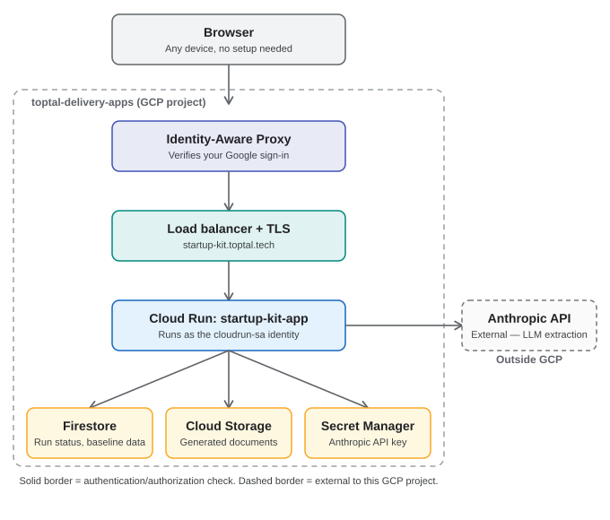

# Cloud Run Deployment — Startup Kit App

This document covers deploying the Startup Kit app to Google Cloud Run in the real
`toptal-delivery-apps` project, building on the Firestore/Cloud Storage backend set up in
`docs/GCP_Firestore_CloudStorage_Setup.md`. That document covers the storage layer; this one
covers running the app itself in the cloud.

Every step below is written to be re-run from scratch by someone who has never done this
before — each check includes the actual command to run, not just a statement of what was found.

## Architecture



A request from a browser is authenticated by Identity-Aware Proxy, passes through the load
balancer (`startup-kit.toptal.tech`, managed certificate), and reaches the Cloud Run service,
which runs as the `cloudrun-sa` identity. From there, the running app reads and writes Firestore
and Cloud Storage, reads the Anthropic API key from Secret Manager, and calls the external
Anthropic API for LLM extraction (the only component outside this GCP project entirely).

---

## 1. Prerequisites

- Real Firestore database and composite index live in `toptal-delivery-apps` (see the other doc)
- Real Cloud Storage bucket `toptal-startup-kit-outputs`, correctly bucket-scoped (not
  project-wide) IAM
- Service account `cloudrun-sa@toptal-delivery-apps.iam.gserviceaccount.com` already has:
  - `Cloud Datastore User` (Firestore read/write)
  - `Storage Object Admin`, scoped to `toptal-startup-kit-outputs` specifically
- `FirestoreReviewStorage` fully implemented, tested against local emulators, and confirmed
  working end-to-end through the real browser UI (`HTL-14`, `HTL-38`)
- A reviewed `Dockerfile` and `.dockerignore` in the repo root, using `python:3.14-slim` to match
  the real locally-tested interpreter, with no secrets or emulator host variables baked in

### Install and authenticate the `gcloud` CLI (one time, per machine)

1. Download and run the installer from `https://cloud.google.com/sdk/docs/install`
   (`GoogleCloudSDKInstaller.exe` on Windows).
2. Open a **brand new** terminal window after install finishes (PATH changes don't apply to
   already-open windows).
3. Confirm it installed:
   ```powershell
   gcloud --version
   ```
4. Authenticate as your real work account (not a personal Gmail — watch for this if the sign-in
   browser prompt defaults to an already-logged-in account):
   ```powershell
   gcloud auth login
   ```
5. Point it at the right project (it may default to an unrelated project from prior work):
   ```powershell
   gcloud config set project toptal-delivery-apps
   ```
6. Confirm both:
   ```powershell
   gcloud auth list
   gcloud config get-value project
   ```
   `gcloud auth list` should show your real work account marked active (`*`);
   `gcloud config get-value project` should print `toptal-delivery-apps`.

---

## 2. Required APIs

### Check what's currently enabled

```powershell
gcloud services list --enabled
```

### Required for this deployment

| API | Why |
|---|---|
| `firestore.googleapis.com` | Run storage backend |
| `storage.googleapis.com` | Generated file storage |
| `run.googleapis.com` | Cloud Run itself |
| `artifactregistry.googleapis.com` | Stores the built container image |
| `cloudbuild.googleapis.com` | Builds the container image from source |
| `secretmanager.googleapis.com` | Stores the LLM API key outside the image |

### If any are missing

Enabling an API requires `roles/serviceusage.serviceUsageAdmin` (or equivalent). If you hit:

```
Missing required permission
You are missing the required permission serviceusage.services.enable on project toptal-delivery-apps.
```

you do not have this role. Request IT enable the **specific missing API by name** (not a broad
admin role) — e.g.: *"Could you enable `secretmanager.googleapis.com` and
`cloudbuild.googleapis.com` on `toptal-delivery-apps`? I'm missing `serviceusage.services.enable`
to do it myself."* Re-run the `gcloud services list --enabled` check above once they confirm.

---

## 3. Required IAM roles

### For the account running `gcloud` (the person deploying)

| Role | Why | How to request if missing |
|---|---|---|
| `roles/artifactregistry.writer` | Required for `gcloud run deploy --source` to create/push to an Artifact Registry repo, **and** required to pull a pre-built image back out for deployment (confirmed: `gcr.io` pushes are backed by Artifact Registry under the hood as of this writing, so this role is needed regardless of which deploy path is used — see Section 5's deviation log) | *"I need `roles/artifactregistry.writer` on `toptal-delivery-apps` to deploy to Cloud Run — both `gcloud run deploy --source` and deploying a pre-built image need it."* |
| `roles/storage.admin` | Creating the Cloud Build staging bucket if it doesn't already exist (Section 5) | Already granted project-wide as of this writing |

### For `cloudrun-sa` (the identity the deployed service runs as)

| Role | Scope | Why |
|---|---|---|
| `roles/datastore.user` | Project-wide | Already granted |
| `roles/storage.objectAdmin` | `toptal-startup-kit-outputs` bucket only | Already granted |
| `roles/storage.legacyBucketReader` | `toptal-startup-kit-outputs` bucket only | **Deviation log, confirmed real:** `objectAdmin` alone is not enough. A real Generate-documents run failed with `403 ... does not have storage.buckets.get access`. `storage.buckets.get` (reading the bucket's own metadata, which the client library calls to confirm the bucket exists before uploading) is a distinct permission from reading/writing/deleting the objects inside it, which is all `objectAdmin` actually covers. Grant both roles together: `gcloud storage buckets add-iam-policy-binding gs://toptal-startup-kit-outputs --member="serviceAccount:cloudrun-sa@toptal-delivery-apps.iam.gserviceaccount.com" --role="roles/storage.legacyBucketReader"`. This takes effect immediately -- no redeploy needed. |
| `roles/secretmanager.secretAccessor` | The `anthropic-api-key` secret only | Granted in Section 4 below |

### How to check your own current roles

Open in a browser:
```
https://console.cloud.google.com/iam-admin/iam?project=toptal-delivery-apps
```
Find your own email in the list and read the roles shown next to it. (If this page itself denies
you with a `resourcemanager.projects.getIamPolicy` error, you don't have permission to view IAM
on this project at all — request `roles/iam.roleViewer` from IT, or just ask them to confirm your
current roles directly.)

---

## 4. Create the Secret Manager secret

**Deviation log, confirmed real on this project — do not use `echo ... | gcloud secrets create ...`
for this.** This was tried first and failed twice, for two different real reasons:

1. The placeholder text in an earlier draft of this instruction (`<your real Anthropic API key>`)
   was literally piped in as the secret's value instead of being replaced with a real key first —
   Secret Manager has no way to know a value isn't real, so it stored the placeholder text as-is,
   and the app failed trying to use it as an API credential.
2. Once the real key was used instead, it *still* failed the same way — PowerShell's `echo` (an
   alias for `Write-Output`) always appends a trailing newline to its output, and
   `--data-file=-` reads stdin completely literally, so that trailing newline became part of the
   stored secret value. An HTTP header can't legally contain a newline, so every real API call
   failed with `httpcore2.LocalProtocolError: Illegal header value b'sk-ant-...\r\n'` — surfaced
   confusingly by higher layers as a generic `anthropic.APIConnectionError: Connection error`,
   which looks like a network problem and is not one.

**The correct way**, which writes the value with no trailing newline:

```powershell
$key = "<your real Anthropic API key, pasted directly — not a placeholder>"
[System.IO.File]::WriteAllText("$env:TEMP\anthropic-key.txt", $key)
gcloud secrets create anthropic-api-key --data-file="$env:TEMP\anthropic-key.txt"
Remove-Item "$env:TEMP\anthropic-key.txt"
```

If the secret already exists and you're rotating the key instead of creating it for the first
time, use `gcloud secrets versions add anthropic-api-key --data-file="$env:TEMP\anthropic-key.txt"`
in place of the `create` line, then redeploy (Section 6) so the running revision picks up the new
version — Cloud Run reads a referenced secret at container startup, not continuously, so an
existing running revision won't see a new secret version until it's redeployed.

Confirm it was created:

```powershell
gcloud secrets describe anthropic-api-key
```

Grant `cloudrun-sa` permission to read it:

```powershell
gcloud secrets add-iam-policy-binding anthropic-api-key `
  --member="serviceAccount:cloudrun-sa@toptal-delivery-apps.iam.gserviceaccount.com" `
  --role="roles/secretmanager.secretAccessor"
```

Confirm the binding:

```powershell
gcloud secrets get-iam-policy anthropic-api-key
```
You should see `cloudrun-sa@...` listed under `roles/secretmanager.secretAccessor`.

**Never** put the real key value directly in a deploy command, a committed file, or a plain
`--set-env-vars` value — only ever via `--set-secrets`, which keeps the real value out of Cloud
Run's own revision metadata and logs.

---

## 5. Build the container image

### Preferred path: let `gcloud run deploy --source` build it automatically

```powershell
gcloud run deploy startup-kit-app `
  --source . `
  --region us-east1 `
  --service-account cloudrun-sa@toptal-delivery-apps.iam.gserviceaccount.com `
  --env-vars-file env-vars.yaml `
  --set-secrets ANTHROPIC_API_KEY=anthropic-api-key:latest `
  --set-secrets ADMIN_PASSPHRASE=admin-passphrase:latest `
  --timeout=1800 `
  --min-instances=1 `
  --no-allow-unauthenticated
```

This single command builds the image via Cloud Build **and** deploys it — skip the manual build
steps below entirely if this works. It requires `roles/artifactregistry.writer` (Section 3).

### If you hit the Cloud Build staging-bucket soft-delete error

```
ERROR: (gcloud.builds.submit) HTTPError 412: '604800' violates constraint 'constraints/storage.softDeletePolicySeconds'
```

This org has a policy rejecting the default 7-day soft-delete duration on new buckets. Cloud
Build auto-creates a staging bucket named `<PROJECT_ID>_cloudbuild` the first time it's used in a
project, and that auto-creation uses the rejected default. Fix by pre-creating it yourself with
soft delete disabled, **before** running the build:

```powershell
gcloud storage buckets create gs://toptal-delivery-apps_cloudbuild `
  --location=us-east1 `
  --soft-delete-duration=0
```

Confirm it exists with the right settings:

```powershell
gcloud storage buckets describe gs://toptal-delivery-apps_cloudbuild
```
Check `retentionDurationSeconds: '0'` in the output. Then retry the build/deploy command above.

**Deviation log, confirmed real on this project — a SECOND, separate bucket hits the same
issue.** `gcloud run deploy --source` (as opposed to plain `gcloud builds submit`) stages its
source upload through a *different* auto-created bucket, named `run-sources-<PROJECT_ID>-<REGION>`
— fixing the `<PROJECT_ID>_cloudbuild` bucket above does **not** cover this one; it hit the exact
same `softDeletePolicySeconds` error independently. Pre-create it the same way, with the real
project ID and region substituted in:

```powershell
gcloud storage buckets create gs://run-sources-toptal-delivery-apps-us-east1 `
  --location=us-east1 `
  --soft-delete-duration=0
```

Confirm it exists with `retentionDurationSeconds: '0'` the same way as above, then retry.

### Manual two-step build (only if `--source` genuinely can't be used)

**Deviation log, confirmed real on this project:** a manual two-step build (build separately, then
deploy from the built image) was tried here as an attempted workaround for a missing
`artifactregistry.writer` grant, on the theory that pushing to the legacy `gcr.io` Container
Registry name might avoid needing Artifact Registry access. **This did not work** — `gcr.io`
pushes are backed by Artifact Registry storage under the hood as of this writing, so the build
step succeeded, but the subsequent deploy step failed pulling the image back out with the same
underlying permission error (`artifactregistry.repositories.downloadArtifacts`). **Conclusion:
`roles/artifactregistry.writer` is required regardless of which path is used — don't spend time on
this workaround again.** The two-step commands are recorded here only for reference:

```powershell
gcloud builds submit --tag gcr.io/toptal-delivery-apps/startup-kit-app
# Check real build status directly if log streaming is denied (see note below):
gcloud builds describe <BUILD_ID> --format="value(status)"

gcloud run deploy startup-kit-app `
  --image gcr.io/toptal-delivery-apps/startup-kit-app `
  --region us-east1 `
  --service-account cloudrun-sa@toptal-delivery-apps.iam.gserviceaccount.com `
  --set-env-vars REVIEW_STORAGE_BACKEND=gcp,GCS_BUCKET_NAME=toptal-startup-kit-outputs,GOOGLE_CLOUD_PROJECT=toptal-delivery-apps,LLM_PROVIDER=anthropic `
  --set-secrets ANTHROPIC_API_KEY=anthropic-api-key:latest `
  --no-allow-unauthenticated
```

**Note on log streaming:** `gcloud builds submit` may return
`This tool can only stream logs if you are Viewer/Owner of the project` even when the build itself
succeeds. This is a separate, narrower permission (live log streaming) from what's needed for the
build to actually complete. Don't treat this message alone as a failure — check the real status
directly via `gcloud builds describe <BUILD_ID> --format="value(status)"` or the Console link
printed alongside the error.

---

## 6. Real deployment command (once `artifactregistry.writer` is granted)

**Deviation log, confirmed real on this project — use a YAML file for environment variables, not
the inline `--set-env-vars a=1,b=2,c=3` form.** The inline comma-separated form was tried first
and failed: in this PowerShell invocation, all four variables were collapsed into a single string
and assigned entirely to `REVIEW_STORAGE_BACKEND`, which the app correctly rejected
(`Unknown REVIEW_STORAGE_BACKEND: 'gcp gcs_bucket_name=... ...'`). Rather than fight PowerShell's
quoting/comma handling, create a YAML file and pass it instead — `gcloud` parses this directly
with no shell-escaping ambiguity:

```powershell
cd C:\Users\james\PycharmProjects\PythonProject\Startup_Kit
@"
REVIEW_STORAGE_BACKEND: "gcp"
GCS_BUCKET_NAME: "toptal-startup-kit-outputs"
GOOGLE_CLOUD_PROJECT: "toptal-delivery-apps"
LLM_PROVIDER: "anthropic"
MAX_TOKENS: "65536"
"@ | Set-Content -Path env-vars.yaml -Encoding utf8
```

(`MAX_TOKENS` is explained below, under "If extraction fails with a truncated-response error.")
This file is local-only scaffolding for the deploy command, not part of the app's own source —
add it to `.gitignore` rather than committing it, and regenerate it (or edit it directly) whenever
a value needs to change, before the next deploy.

```powershell
gcloud run deploy startup-kit-app `
  --source . `
  --region us-east1 `
  --service-account cloudrun-sa@toptal-delivery-apps.iam.gserviceaccount.com `
  --env-vars-file env-vars.yaml `
  --set-secrets ANTHROPIC_API_KEY=anthropic-api-key:latest `
  --set-secrets ADMIN_PASSPHRASE=admin-passphrase:latest `
  --timeout=1800 `
  --min-instances=1 `
  --no-allow-unauthenticated
```

### If extraction fails with a truncated-response error

```
extraction failed: Anthropic response was truncated due to reaching max_tokens (16384). Payload is incomplete and cannot be parsed safely.
```

This means the model's real response for a given SOW was larger than the configured `MAX_TOKENS`
ceiling, and the app correctly refused to parse an incomplete payload rather than silently
producing wrong data. The configured model (`claude-sonnet-5-5`, as of this writing) supports up
to 128K output tokens on the standard synchronous API — well above the default `MAX_TOKENS=16384`
some SOWs can exceed, especially larger or more structurally complex ones, or ones that produce
many distinct deliverables (see `MAP-16` in the spec). Raise `MAX_TOKENS` in `env-vars.yaml` (e.g.
to `32768` or `65536` — a conservative step up rather than jumping straight to the full 128K, since
a higher ceiling can mean higher cost/latency if the model actually uses that much space) and
redeploy.

### Why each flag is set the way it is

- **`--source .`** — builds the container from the repo's own `Dockerfile` via Cloud Build
  automatically, as part of this one command.
- **`--region us-east1`** — matches Firestore and Cloud Storage's region.
- **`--service-account cloudrun-sa@...`** — the identity the running container authenticates as.
  With no `FIRESTORE_EMULATOR_HOST`/`STORAGE_EMULATOR_HOST` set, the real client libraries fall
  through to Application Default Credentials — i.e. this service account's real identity.
- **`REVIEW_STORAGE_BACKEND=gcp`** — selects `FirestoreReviewStorage` over the local-file backend.
- **`GCS_BUCKET_NAME` / `GOOGLE_CLOUD_PROJECT`** — read by `src/storage/firestore_client.py` and
  `src/storage/gcs_client.py` as their defaults; set explicitly for clarity.
- **`--set-secrets ANTHROPIC_API_KEY=anthropic-api-key:latest`** — injects the real key at
  container start from Secret Manager; `:latest` means "always use the most recent version"
  without needing to redeploy when the key rotates.
- **`--set-secrets ADMIN_PASSPHRASE=admin-passphrase:latest`** — **deviation log, confirmed
  real:** this was missing from every deploy command after the interim app-wide passphrase gate
  was reverted (see Section 0 history) — but the revert only removed the *outer* gate; the app's
  pre-existing, separate "Advanced (admin)" section inside the Generate page (its own passphrase
  check, unrelated to that reverted experiment) still reads `config.admin_passphrase` at runtime.
  With no secret wired in, the deployed container silently fell back to `config.py`'s hardcoded
  default, `"dev-only-change-me"` — meaning the real admin section was accessible in production
  with a well-known, publicly-visible-in-source-code value, not actually protected at all. Confirm
  the real secret's value and access are in place (see Section 4) before relying on this.
- **`--min-instances=1`** — **deviation log, confirmed real:** without this, Cloud Run's default
  (`minScale` unset, i.e. `0`) lets the service scale down to zero containers whenever idle. The
  next request after any idle period then triggers a full cold start — pulling the image, starting
  Python, importing this app's genuinely large dependency tree (`pandas`, `python-docx`,
  `python-pptx`, `openpyxl`, the Anthropic/LangChain SDKs, `google-cloud-firestore`,
  `google-cloud-storage`, `pymupdf`, and more), then initializing Streamlit itself — confirmed as
  the real cause of a slow startup noticed in practice, by checking the service's actual
  `minScale` annotation (it was empty/unset). Keeping one instance warm at all times fixes this,
  at a real, honest tradeoff: the service is never fully "off," so there's a small ongoing cost
  for that one warm instance even when nobody's using the app — worth it for a frequently-used
  internal tool, worth reconsidering if usage turns out to be rare.
  **Confirmed real behavior worth knowing:** changing `--min-instances` (or any config flag)
  creates a *new* revision, and that new revision's first warm instance still takes a moment to
  actually finish starting up right after the rollout — a request landing in that brief window can
  still see one cold-start-like delay even with `--min-instances=1` already set. This is expected
  and temporary, confirmed by testing twice in a row shortly after applying the change: the first
  attempt was still slow, the second (moments later) was not.
- **`--no-allow-unauthenticated`** — deliberate choice given this app handles real client SOW
  content: nobody can reach the deployed URL without being explicitly granted access (Section 7).

### Explicitly NOT set

`FIRESTORE_EMULATOR_HOST`, `STORAGE_EMULATOR_HOST` — their absence is what makes real cloud auth
work; these exist only for local development against the emulators.

---

## 7. Grant access

**Update — superseded by IAP, which is now the real, working access method.** As of the real IAP
rollout (see `docs/IAP_Setup_Plan.md` Section 0), the app is reachable at
**`https://startup-kit.toptal.tech/`** with a genuine Google sign-in redirect — no `gcloud`, no
proxy, no CLI needed. This is now the normal way to use the app; the `run.invoker` /
`gcloud run services proxy` method below still works as a fallback (e.g., accessing the service
directly during troubleshooting) but is no longer the primary access path for real users.

Confirm the service exists and check who currently has `run.invoker` (the fallback path):

```powershell
gcloud run services describe startup-kit-app --region us-east1 --format="value(status.url)"
gcloud run services get-iam-policy startup-kit-app --region us-east1
```

Grant each person who needs the fallback access:

```powershell
gcloud run services add-iam-policy-binding startup-kit-app `
  --region us-east1 `
  --member="user:james.mora@toptal.com" `
  --role="roles/run.invoker"
```

Repeat with a different `--member` value (e.g. `user:colleague@toptal.com`) for each additional
person.

**For real, day-to-day use, grant access via IAP instead** — see `docs/IAP_Setup_Plan.md`
Section 0 for the real, current status of how new colleagues are granted access through
`startup-kit.toptal.tech` (confirming with IT whether this is self-service or needs to go through
them is still an open item as of this writing).

---

## 8. Post-deployment verification (do this for real, every time — don't assume success)

1. Get the real service URL:
   ```powershell
   gcloud run services describe startup-kit-app --region us-east1 --format="value(status.url)"
   ```
2. Open it in a browser as a granted, authenticated user; confirm the app actually loads (not a
   403 or a blank page).
3. Run a real Generate against a real SOW, through Fact Review, approve, and Generate documents.
4. Confirm the run's data genuinely lands in the real Firestore database:
   `https://console.cloud.google.com/firestore/databases/-default-/data/panel?project=toptal-delivery-apps`
5. Confirm the generated files genuinely land in the real bucket:
   `https://console.cloud.google.com/storage/browser/toptal-startup-kit-outputs`
6. Confirm download buttons work against the real deployed Cloud Storage data (this exact path
   was the subject of `HTL-38`'s fix — re-confirm it specifically against the real cloud
   deployment, not just the local emulators).

### Convenience script

`deploy-and-verify.ps1`, in the repo root, packages the redeploy and verification sequence into
one script: pushes pending commits, confirms `env-vars.yaml` exists, runs the real deploy command
from Section 6, shows who currently has `run.invoker`, and launches the authenticated proxy with
on-screen instructions. Run with:
```powershell
cd C:\Users\james\PycharmProjects\PythonProject\Startup_Kit
.\deploy-and-verify.ps1
```
It stops immediately if the push or the deploy fails, rather than proceeding on top of a failure.

For simply reconnecting to the already-deployed app on a normal day (no redeploy needed),
`open-deployed-app.ps1`, also in the repo root, wraps just the authenticated proxy step:
```powershell
.\open-deployed-app.ps1
```
This is the one real limitation of today's `run.invoker`-based access model, worth remembering
until IAP (see `docs/IAP_Setup_Plan.md`) replaces it: there is no way to just open a URL directly
in a browser yet, this proxy step is required every time.

---

## 9. Status as of this writing

- [x] `gcloud` installed, authenticated as `james.mora@toptal.com`, project set correctly
- [x] `secretmanager.googleapis.com` and `cloudbuild.googleapis.com` enabled
- [x] `roles/artifactregistry.writer` granted — this did resolve both deploy-path permission
      errors described in Section 5's deviation log
- [x] Cloud Build staging bucket soft-delete issue hit and fixed (`<PROJECT_ID>_cloudbuild`)
- [x] A **second**, different staging bucket required the same fix: `gcloud run deploy --source`
      uses its own bucket, named `run-sources-<PROJECT_ID>-<REGION>`, separate from the
      `<PROJECT_ID>_cloudbuild` one `gcloud builds submit` uses — pre-create it the same way
      (`gcloud storage buckets create gs://run-sources-toptal-delivery-apps-us-east1 --location=us-east1 --soft-delete-duration=0`)
      before the first `--source` deploy
- [x] The first real `gcloud run deploy` succeeded — service `startup-kit-app` is live in
      `us-east1`
- [x] Confirmed reachable via `gcloud run services proxy` (which required installing the
      `cloud-run-proxy` component on first use — accept the prompt)
- [x] `roles/run.invoker` granted to `james.mora@toptal.com`
- [x] **Real deviation, now fixed in Section 4 above:** the secret was created twice incorrectly
      before working — once with a literal placeholder string piped in by mistake, and once with
      the real key but a trailing newline appended by PowerShell's `echo`, which produced an
      illegal HTTP header value. Both surfaced as a misleading `anthropic.APIConnectionError:
      Connection error` that looked like a network problem and wasn't one. Section 4 now uses
      `[System.IO.File]::WriteAllText` instead of `echo | ...`, which avoids the trailing newline.
      **A redeploy is required after adding a new secret version** — Cloud Run reads a referenced
      secret at container startup only, not continuously, so an already-running revision keeps
      using whatever value it started with.
- [x] **Real deviation, now fixed in Section 6 above:** the inline `--set-env-vars a=1,b=2,c=3`
      form failed in PowerShell, collapsing all four variables into one and being assigned
      entirely to `REVIEW_STORAGE_BACKEND`. Switched to `--env-vars-file env-vars.yaml`, which
      sidesteps shell quoting/comma-splitting ambiguity entirely.
- [x] **Real deviation, now fixed:** once connectivity and the secret were both correct,
      extraction still failed with `Anthropic response was truncated due to reaching max_tokens
      (16384)` — the configured ceiling was too low for a real SOW's full response (the model
      supports up to 128K). Raised `MAX_TOKENS` via `env-vars.yaml` (see Section 6).
- [x] **Real deviation, now fixed (Section 3 above):** `storage.objectAdmin` alone was not
      enough for Generate documents to succeed — it covers objects inside the bucket but not
      `storage.buckets.get` (reading the bucket's own metadata), which the client library checks
      first. Real failure: `403 ... does not have storage.buckets.get access`. Fixed by also
      granting `roles/storage.legacyBucketReader` on the same bucket. Took effect immediately,
      no redeploy needed.
- [x] **Confirmed: a real Generate succeeded end-to-end** against the deployed service — a real
      run (`Pilot-Ready_Product_Implementation_20261021_024339`) was created, reviewed in Fact
      Review, approved, and successfully generated documents, with the corrected secret, the
      raised `MAX_TOKENS`, and both `cloudrun-sa` Storage roles in place.
- [ ] Independently re-confirm the generated run's data in the real Firestore Console and the
      real bucket browser directly (Section 8, steps 4-5) — the in-app success was observed, but
      hasn't yet been independently cross-checked against the Firestore/Storage Console UIs the
      way local-emulator runs were earlier this project
- [ ] Confirm download buttons work against the real deployed Cloud Storage data specifically
      (Section 8, step 6; `HTL-38`'s original fix was confirmed working against the local
      emulators, not yet re-confirmed against this real deployment)
- [x] **Interim access control attempted, then reverted — do not retry this approach.** An
      app-level `ADMIN_PASSPHRASE` gate (replacing the per-person `run.invoker` IAM model with
      `--allow-unauthenticated` plus a shared in-app passphrase) was built, tested, and committed,
      then deployed. The deploy succeeded, but Cloud Run's own `Setting IAM Policy` step failed
      with a warning when granting `allUsers` the `run.invoker` role needed for
      `--allow-unauthenticated` to actually work. Investigation confirmed the real cause: this
      org's effective `constraints/iam.allowedPolicyMemberDomains` policy permits only specific
      Workspace customer IDs, and `allUsers` can never satisfy a domain restriction by definition
      — meaning **unauthenticated public access to this service is permanently disallowed by org
      policy**, not a temporary permission gap. The passphrase-gate commit was reverted
      (`git revert`) and the service redeployed with `--no-allow-unauthenticated`, the original,
      correct posture. **Conclusion: real Google-account-based access (per-person `run.invoker`
      grants, Section 7) is the only access model this org's policy permits short of a proper
      Identity-Aware Proxy setup — don't attempt a shared-passphrase/public-access workaround
      again.** IAP remains the right path for a smoother, no-CLI browser experience for
      colleagues, and is still a real, separate piece of future work, not yet started.
